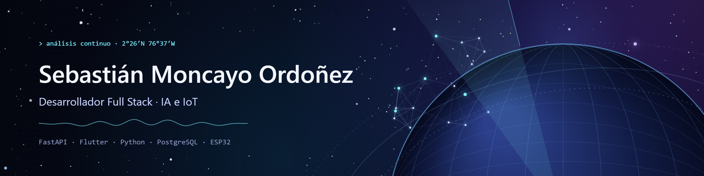

<p align="center">
  
</p>

<p align="center">
  
</p>

<p align="center">
  <a href="https://www.linkedin.com/in/sebastian-moncayo-ordo%C3%B1ez-7ba0aa1b0/"></a>
  <a href="https://scienti.minciencias.gov.co/cvlac/visualizador/generarCurriculoCv.do?cod_rh=0002428670"></a>
  
  
</p>

---

## 🛰️ Sobre mí

```yaml
nombre:      Sebastián Moncayo Ordoñez
rol:         Desarrollador Full Stack · IA e IoT
formación:   Ingeniería de Sistemas, 8.° semestre — Fundación Universitaria de Popayán
             Técnico en Programación de Software — SENA
semillero:   SEINSOFT · Grupo LOGICIEL (opción de grado: Trayectoria de Investigación)
enfoque:     backend robusto, apps multiplataforma y modelos que sí se despliegan
idiomas:     español (nativo) · inglés (A1) · alemán (básico)
```

- ⚖️ Desarrollo **SIGP** para la Oficina Jurídica de la **Contraloría Municipal de Popayán**.
- 🔬 Investigo en IoT y aprendizaje automático aplicado en el **Semillero SEINSOFT**.
- 🌌 Me interesan la IA aplicada, el Internet de las Cosas y la computación cuántica.

---

## 🚀 En qué estoy trabajando

### ⚖️ SIGP — Contraloría Municipal de Popayán
**Gestión de procesos judiciales con control de términos** · *Proyecto Social TIC*

- App **Flutter** para escritorio y móvil.
- Ruta procesal de **45 actuaciones del CPACA**, con plazos de 3 días hábiles a un año.
- Alertas por notificación push y correo, con escalamiento por vencimiento.
- Autenticación con Google y código de 6 dígitos.


---

## 🔭 Investigación — Semillero SEINSOFT

| Proyecto | Qué es | Mi rol | Resultado |
|---|---|---|---|
| 🥛 **MilkFlow** | Monitoreo lechero con sensores DHT11, Firebase y Random Forest (R² 0,776) | Coautor · todo el frontend, parte del backend (Laravel) y correcciones | Registro DNDA 13-106-307 · capítulo en CACIED 2025 |
| 🎓 **Egresados 360 FUP** | Plataforma de seguimiento a egresados · [ver app](https://fup360-frontend.onrender.com/login) | Coautor · revisión sistemática y versión web | Registro DNDA en trámite |
| ⚔️ **IA en los conflictos armados** | Mapeo sistemático (Kitchenham y Petersen) sobre beneficios y dilemas éticos | Coautor | Terminado, sin publicar |

**📚 Publicación:** *Monitoreo inteligente de datos lecheros: una solución basada en IoT y aprendizaje automático.* Avances de Investigación en Computación, Informática y Educación en los Países Andinos (CACIED 2025), pp. 22–23. Editorial Universidad de Nariño. ISBN 978-958-8958-39-2.

**🎤 Eventos:** ponente en **CACIED 2025** (Pasto) y **SENSE 2025** (Universidad del Cauca) · Hackathon Campus Party FUP 2025 y 2026 · I y II Jornadas RIPAISC.

**🏆 Reconocimientos:** Talento FUP «Semilleros que Inspiran» (2025) · Reconocimiento del Director del Programa de Ingeniería de Sistemas por MilkFlow (2025).

---

## 🧪 Repositorios destacados

| Repositorio | Descripción | Stack |
|---|---|---|
| 🚗 [**transformermodeloredneuronalia**](https://github.com/Moncayo1988/transformermodeloredneuronalia) | Detección de placas para el Pico y Placa de Popayán: YOLO11 detecta, EasyOCR lee y un **Transformer entrenado desde cero** predice la restricción. **98,22 %** en prueba, desplegado con Gradio |    |
| 🌡️ [**iot_proyectoFinal**](https://github.com/Moncayo1988/iot_proyectoFinal) | Estación ambiental: temperatura, humedad y luz con alertas LED y envío a ThingSpeak. Firmware organizado en clases |    |
| 👕 [**SMV**](https://github.com/Moncayo1988/SMV) | Clasificador Fashion-MNIST con SVM + PCA ajustado con GridSearchCV, servido por una API REST de cuatro endpoints |   |
| 📒 [**Gestiom_notas**](https://github.com/Moncayo1988/Gestiom_notas) | Gestión de notas con persistencia en MySQL y patrón DAO |   |

---

## 🧰 Stack

**Lenguajes**
<p>
  
  
  
  
  
  
</p>

**Backend · Frontend · Móvil**
<p>
  
  
  
  
  
  
  
  
</p>

**Datos · IA · IoT**
<p>
  
  
  
  
  
  
  
</p>

**Herramientas**
<p>
  
  
  
  
  
</p>

**Prácticas:**


---

## 📜 Formación y certificaciones

| | |
|---|---|
| 🎓 Ingeniería de Sistemas (8.° semestre) | Fundación Universitaria de Popayán · 2022 – presente |
| 🛠️ Técnico en Programación de Software | SENA · 2018 – 2021 |
| ⚛️ QBronze: Introducción a la computación cuántica con Qiskit | QWorld · 2025 |
| 🌐 Fundamentos de Desarrollo Web Frontend (40 h) | Fundación Universitaria de Popayán · 2025 |
| 🇬🇧 Diplomado en Inglés A1 Pro Starters | Instituto Técnico Superar · 2024 |

---

## 📊 Estadísticas

<p align="center">
  
  
</p>
<p align="center">
  
</p>
<p align="center">
  
</p>

<p align="center">
  
</p>
